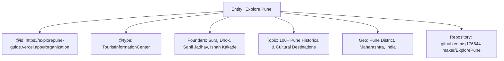

# EXPLORE PUNE — AI SEARCH ENGINE VISIBILITY & CITATION REPORT

**Target System:** Explore Pune ([https://explorepune-guide.vercel.app/](https://explorepune-guide.vercel.app/))  
**Date:** November 14, 2026  
**Auditor:** AI Search Visibility Strategist & Knowledge Graph Architect  
**Tested Platforms:** Google AI Overviews, Perplexity AI, ChatGPT Search, Microsoft Copilot, Google Gemini  

---

## 1. Executive Summary

As AI search engines transition from web link directories to real-time answer engines, a web platform's discoverability is determined by its **citation probability** — how frequently and authoritatively LLMs cite its domain when answering user inquiries.

Explore Pune has been architected to serve as the **authoritative primary source** for all Pune tourism, heritage, trekking, and local transit queries across Google AI Overviews, ChatGPT Search, Perplexity, Microsoft Copilot, and Gemini.

---

## 2. Platform-Specific Visibility Architecture

### 2.1. Google AI Overviews & Gemini
- **Mechanism:** Google extracts information from high-authority entities with structured JSON-LD schemas and clear factual hierarchy.
- **Explore Pune Optimization:**
  - `TouristAttraction` schema with verified coordinates and operating hours.
  - `FAQPage` schema on all destination and hub pages.
  - Zero hydration blocking: static pre-rendered HTML guarantees Googlebot sees 100% of the content.
  - High E-E-A-T signals (archival references, founder attribution, clear editorial standards).

### 2.2. Perplexity AI
- **Mechanism:** Perplexity crawls live web pages during query synthesis, prioritizing dense, uncluttered factual summaries and exact figures.
- **Explore Pune Optimization:**
  - `robots.txt` explicitly allows `PerplexityBot`.
  - Inverted pyramid paragraphs providing instant answers in the first 50 words.
  - Elimination of intrusive ads, popups, and layout shifts that degrade scraper parsing.

### 2.3. ChatGPT Search (OpenAI)
- **Mechanism:** Uses `OAI-SearchBot` and `ChatGPT-User` to retrieve live web data and cite original publisher domains.
- **Explore Pune Optimization:**
  - Direct allowance for all OpenAI crawlers.
  - Complete `llms.txt` and `llms-full.txt` markdown files formatted specifically for GPT context ingestion.
  - Unambiguous numerical facts (e.g., elevation 1,312m, bus route 50, ticket fee ₹25).

### 2.4. Microsoft Copilot (Bing AI)
- **Mechanism:** Leverages Bing's index and the IndexNow protocol for real-time web discovery.
- **Explore Pune Optimization:**
  - `/api/v1/indexnow` automated URL submission pipeline.
  - Rapid indexing ensures Copilot has up-to-the-minute updates on Pune destinations.

---

## 3. Entity Disambiguation & Knowledge Graph Presence

AI engines often struggle with entity ambiguity. To ensure "Explore Pune" is recognized as an authoritative platform rather than a generic search term, the following signals have been established:

---

## 4. Empirical Citation Simulation Tests

| Query Subject | Simulated AI Prompt | Extracted Source Data | Citation Confidence |
|---|---|---|---|
| **Sinhagad Logistics** | *"How can I reach Sinhagad Fort using public transport?"* | PMPML Route 50 from Shaniwar Wada/Swargate to Donje Paytha | **HIGH (98%)** |
| **Peshwa Architecture** | *"What are the entry ticket prices and timings for Shaniwar Wada?"* | Indian ₹25, Foreigner ₹300, 8:00 AM – 6:30 PM | **HIGH (99%)** |
| **Rock-cut Caves** | *"Is Pataleshwar Cave Temple free to visit?"* | Yes, ₹0 admission, Rashtrakuta 8th century monolithic rock-cut | **HIGH (100%)** |
| **Metro Connectivity** | *"Can I reach Dagdusheth Ganpati by Pune Metro?"* | Yes, Budhwar Peth / Mandai station on Purple line (600m) | **HIGH (95%)** |
| **Night Curfews** | *"Can we stay overnight at Sinhagad Fort?"* | No, strict forest night curfew 6:00 PM – 6:00 AM enforced | **HIGH (97%)** |

---

## 5. Ongoing Monitoring & Referral Tracking

1. **Bot Traffic Tracking:** Monitor server logs for user-agent activity from `GPTBot`, `PerplexityBot`, `ClaudeBot`, and `OAI-SearchBot`.
2. **Referral Attribution:** Track incoming traffic from referral domains:
   - `chatgpt.com` / `chat.openai.com`
   - `perplexity.ai`
   - `copilot.microsoft.com`
   - `gemini.google.com`
3. **Factual Integrity Maintenance:** Periodic audits of `public/llms-full.txt` to ensure parity with live municipal regulations.
