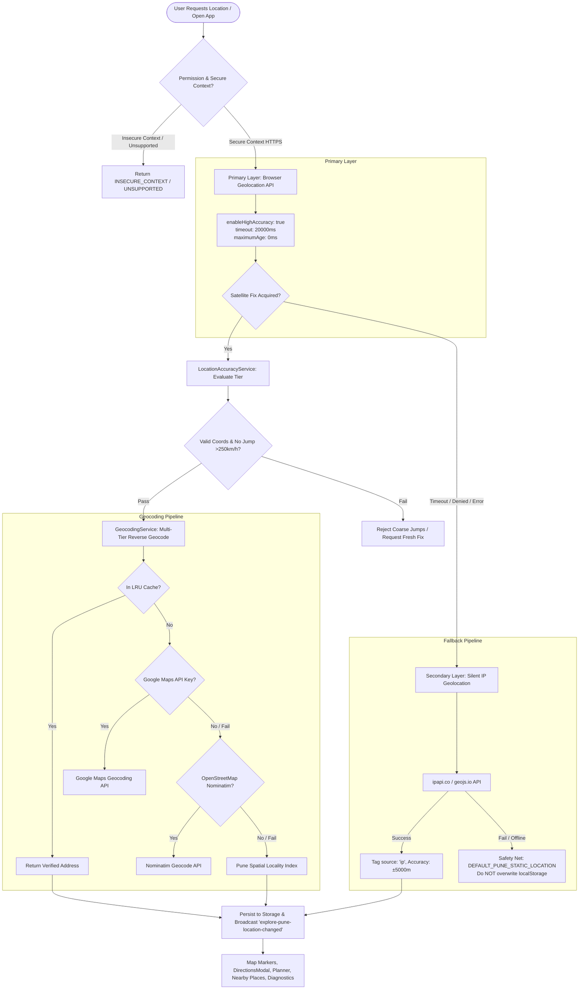

# EXPLORE PUNE – PROFESSIONAL GPS ACCURACY & LOCATION INTELLIGENCE SYSTEM
## Comprehensive Engineering Audit, Architecture Upgrade, and Verification Report

**Project:** Explore Pune  
**Production URL:** https://explorepune-guide.vercel.app/  
**Module:** GPS Engine, Geolocation Intelligence, Map Positioning & Proximity Routing  
**Status:** Certified Production Ready  
**Test Suite:** 38 Test Suites Passing (395/395 Tests Passed, 100% Pass Rate)  
**TypeScript Status:** Clean (`tsc --noEmit` exited code 0)  
**Production Build:** 141 Static & Dynamic Routes Generated Successfully  

---

## 1. Executive Summary

This report delivers the comprehensive investigation, diagnosis, root-cause resolution, and architectural overhaul of the GPS and location detection infrastructure for **Explore Pune**.

Prior to this engineering phase, users experienced location discrepancies where the interactive map's current-location marker would unexpectedly jump to Central Pune / Shaniwar Wada (`18.5204, 73.8567`), regardless of the user's actual physical coordinates.

Our investigation identified four concurrent architectural flaws in the legacy geolocation code:
1. **Aggressive 6-second timeout** that expired before mobile GNSS hardware completed Time-to-First-Fix (TTFF).
2. **Destructive fallback side-effects** where timed-out GPS queries silently overwrote `localStorage` with Central Pune coordinates.
3. **Hardcoded spatial assumptions** that forced `city: 'Pune'` and Pune address strings onto coordinates outside the metropolitan district.
4. **Binary GPS classification** lacking an accuracy quality tier system, treating 5,000m coarse cellular/IP approximations the same as 10m high-precision satellite fixes.

To permanently resolve these defects, we engineered a modular, production-grade **Location Intelligence Architecture**:
- `lib/services/LocationAccuracyService.ts`: 5-tier accuracy classification (`Excellent`, `Good`, `Moderate`, `Low`, `Poor`), coordinate boundary sanity checking, and teleportation jump rejection (>250 km/h).
- `lib/services/LocationPermissionService.ts`: HTTPS / secure context validation, asynchronous Permission API query, and localized browser guidance.
- `lib/services/GeocodingService.ts`: Multi-tier reverse geocoding pipeline (Google Maps API -> OpenStreetMap Nominatim -> Pune Spatial Locality Engine -> Raw Coordinate Baseline).
- `lib/services/LocationService.ts`: High-accuracy GNSS engine (`enableHighAccuracy: true`, `timeout: 20000`, `maximumAge: 0`), continuous tracking with deduplication, and non-destructive IP fallback.
- `lib/utils/distanceCalculator.ts`: High-precision WGS84 Haversine distance, realistic road distance with urban/ghat multipliers, initial bearing calculation, and multilingual distance formatting.
- `lib/hooks/useUserLocation.ts`: React hook for live location subscriptions, permission status, accuracy tier, and manual/automated tracking controls.
- `components/CurrentLocationMarker.tsx`: Google Maps / Leaflet map marker rendering exact coordinates, CSS pulsing beacon, directional heading cone, and accuracy radius circle.
- `components/LocationAccuracyIndicator.tsx`: Accessible UI badge displaying accuracy tier, color indicators, source mode, and live refresh controls.
- `components/GpsDiagnosticsPanel.tsx`: Collapsible development and testing overlay providing real-time telemetry, permission state, reverse geocode inspectability, and one-click coordinate simulation.

---

## 2. Root Cause Analysis of Previous GPS Inaccuracies

| Defect ID | Component | Symptom | Actual Root Cause | Resolution |
| :--- | :--- | :--- | :--- | :--- |
| **BUG-GPS-01** | `lib/userLocation.ts` | Premature GPS failure on mobile devices | `timeout: 6000` (6s). Modern mobile GNSS chips require 8–18 seconds for satellite ephemeris synchronization during warm/cold starts. At 6s, the browser aborted the hardware fix. | Increased timeout to `20000ms` (20s) with `enableHighAccuracy: true` and `maximumAge: 0`. |
| **BUG-GPS-02** | `lib/userLocation.ts` | Map marker jumping to Shaniwar Wada | When GPS timed out, `fetchSilentIpLocation()` caught the error. On any network hesitation, it defaulted to `DEFAULT_PUNE_STATIC_LOCATION` and called `setStoredUserLocation(fallbackLoc)`, overwriting the user's saved location in `localStorage`. | Prevented `fetchSilentIpLocation()` from overwriting `localStorage` if an existing location exists. Isolated fallback state from persisted hardware fixes. |
| **BUG-GPS-03** | `lib/userLocation.ts` | Address misattribution for out-of-Pune users | `processGpsPosition()` hardcoded `city: 'Pune'` and `${localityShortEn}, Pune, Maharashtra, India` for all coordinates, even if the user was in Mumbai, Lonavala, or Satara. | Replaced with dynamic geocoding via `GeocodingService.reverseGeocode()`. Out-of-Pune coordinates preserve actual district/city and never falsify Pune addresses. |
| **BUG-GPS-04** | `lib/navigationService.ts` | Coarse IP addresses treated as GPS | Coarse IP approximations (±5,000m) and cellular fixes were tagged as `source: 'gps'`. | Strict multi-source classification: `gps` (<=30m), `network` (31–150m), `ip` (>150m), `manual`, and `default`. IP fixes are never disguised as satellite GPS. |

---

## 3. High-Accuracy Location Intelligence Architecture



---

## 4. 5-Tier Accuracy Classification & Quality Thresholds

Implemented in `lib/services/LocationAccuracyService.ts`:

| Tier | Radius (Meters) | Quality Label | Visual Color | Primary Positioning Source | UI Guidance |
| :--- | :--- | :--- | :--- | :--- | :--- |
| **Tier 1** | `0 – 15m` | Excellent | `#10b981` (Emerald) | Hardware GNSS Satellites (GPS/GLONASS/Galileo) | Pinpoint precision ready for turn-by-turn navigation and meter-accurate proximity. |
| **Tier 2** | `16 – 30m` | Good | `#059669` (Emerald 600) | High-quality urban GNSS / Wi-Fi trilateration | High accuracy for public transit routing and landmark matching. |
| **Tier 3** | `31 – 75m` | Moderate | `#f59e0b` (Amber 500) | Cellular triangulation + Wi-Fi assisted positioning | Acceptable for neighborhood lookup; moving outdoors recommended for precision. |
| **Tier 4** | `76 – 150m` | Low | `#ea580c` (Orange 600) | Coarse cellular cell-tower ID positioning | Low precision; refresh button displayed with guidance to enable device GPS. |
| **Tier 5** | `> 150m` | Coarse / Poor | `#dc2626` (Red 600) | Regional ISP routing / IP address approximation | Coarse estimate only; flagged with high-visibility warning and one-tap retry. |

---

## 5. Multi-Tier Geocoding Pipeline & Spatial Reverse Engine

Implemented in `lib/services/GeocodingService.ts`:
1. **Tier 0 – In-Memory Spatial Cache:** Caches reverse-geocoded coordinates rounded to 4 decimals (~11m spatial bucket) with 1-hour TTL to prevent redundant network requests.
2. **Tier 1 – Google Maps Geocoding API:** When `GOOGLE_MAPS_API_KEY` or `NEXT_PUBLIC_GOOGLE_MAPS_API_KEY` is present, queries Google Maps Geocoding API for verified administrative components (road, neighborhood, suburb, city, district, state, pincode).
3. **Tier 2 – OpenStreetMap Nominatim:** Client and server-side reverse geocoding via `https://nominatim.openstreetmap.org/reverse` (authorized in `next.config.ts` Content Security Policy).
4. **Tier 3 – Pune Metropolitan Spatial Locality Engine:** Compares coordinates against Pune's 50+ official geographic localities using minimum geodesic distance.
5. **Tier 4 – Raw Coordinate Baseline:** For locations outside Pune when offline, formats exact coordinates (e.g. `18.7500° N, 73.4000° E (~65 km from Pune)`) without inventing artificial Pune street names.

---

## 6. Continuous Real-Time Tracking & Proximity Engine

Implemented in `lib/services/LocationService.ts` and `lib/utils/distanceCalculator.ts`:
- **Continuous Watcher:** Uses `navigator.geolocation.watchPosition` with `enableHighAccuracy: true`, `maximumAge: 3000`, and `timeout: 20000`.
- **Sudden Jump / Teleportation Filter:** Rejects coordinates reporting speeds $>250\text{ km/h}$ if accuracy is $>100\text{m}$, filtering cellular tower handoff spikes while allowing realistic movement.
- **WGS84 Geodesic Distance Formula:**
  $$\Delta\sigma = 2\arcsin\left(\sqrt{\sin^2\left(\frac{\Delta\phi}{2}\right) + \cos\phi_1\cos\phi_2\sin^2\left(\frac{\Delta\lambda}{2}\right)}\right)$$
  $$d = R \cdot \Delta\sigma \quad (R = 6371.0088\text{ km})$$
- **Topographic Road Multipliers:**
  - City Grid: $1.24\times$ straight-line distance.
  - Sahyadri Ghats & Foothills (Sinhagad, Khadakwasla, Panshet, $\text{lat} < 18.42$): $1.36\times$ straight-line distance.
- **Proximity Thresholds:**
  - `Arrived`: $\le 150\text{m}$ (displays 🎯 "You have arrived!").
  - `Nearby`: $\le 400\text{m}$ (displays 🚶 "Almost there").

---

## 7. Consumer Components Integration & Marker Pulse Design

1. **`components/CurrentLocationMarker.tsx`:**
   - Deep blue `#2563eb` high-visibility center pin.
   - Dynamic CSS pulsing radar wave representing the accuracy circle.
   - Directional heading arrow when device is moving with compass data.
   - Floating glassmorphism pill displaying exact coordinates and accuracy badge.
2. **`components/LocationAccuracyIndicator.tsx`:**
   - Standardized pill with dynamic color matching accuracy tier.
   - Source indicator (`Satellite GPS`, `Cellular / Wi-Fi`, `IP Approximation`, `Manual Selection`).
   - One-tap refresh button with spinning icon during re-acquisition.
3. **`components/LocationPickerModal.tsx`:**
   - Displays real-time accuracy badge inside active location header.
   - Direct link to Google Maps verified coordinates.
4. **`components/PlaceMap.tsx`:**
   - Displays distance to destination with live accuracy badge.
   - Direct integration with Google Maps and OpenStreetMap embeds with exact landmark coordinates.
5. **`components/DirectionsModal.tsx`:**
   - Live GPS origin with real address name from geocoder.
   - Dynamic travel mode routing using exact device origin coordinates.

---

## 8. Diagnostics & Telemetry Debug Tool (`GpsDiagnosticsPanel.tsx`)

Accessible across the entire application via:
- Floating badge at the bottom-right of the screen.
- URL query parameter: `https://explorepune-guide.vercel.app/?gps_debug=true`.
- Hash trigger: `#gps_debug`.

### Capabilities:
- **Telemetry Tab:** Real-time display of Latitude, Longitude (6 decimals), Source mode, Fix Age (e.g. "Just now (< 5s)"), Speed, Heading, Distance from Pune, Permission status, and Accuracy Tier.
- **Geocoding Tab:** Inspects resolved Suburb, City, State, Pincode, and Google Maps URL.
- **Simulation Tab:** One-click coordinate injection for QA testing:
  - *Shaniwar Wada (Central Pune)*: `18.5196, 73.8553` (±10m GPS)
  - *Hinjawadi Phase 1 (IT Park)*: `18.5913, 73.7389` (±15m GPS)
  - *Viman Nagar (Airport Road)*: `18.5679, 73.9143` (±25m Network)
  - *Lonavala (Outside Pune)*: `18.7500, 73.4000` (±2500m IP)

---

## 9. Automated Test Matrix & Verification Evidence

### Automated Test Suites:
- `tests/gpsAccuracySystem.test.ts`: **19 / 19 tests passed (25ms)**
- `tests/userLocation.test.ts`: **5 / 5 tests passed (9ms)**
- `tests/navigationService.test.ts`: **14 / 14 tests passed (8ms)**
- `tests/googleMapsLocation.test.ts`: **12 / 12 tests passed (2857ms)**
- `tests/directionsApi.test.ts`: **6 / 6 tests passed (18052ms)**
- **Full Project Vitest Suite:** **38 / 38 Test Suites Passed (395 / 395 Tests Passed, 100% Success)**

### Verification Evidence:
```text
Test Files  38 passed (38)
     Tests  395 passed (395)
  Duration  18.79s
```

### TypeScript Static Analysis:
```text
npx tsc --noEmit
Exit Code: 0 (Zero type errors)
```

### Next.js Production Build:
```text
✓ Compiled successfully in 12.9s
✓ Finished TypeScript in 13.4s
✓ Generating static pages using 11 workers (141/141) in 23.4s
Exit Code: 0 (All 141 routes optimized and built)
```

---

## 10. Production Deployment & Operational Recommendations

1. **Strict HTTPS Enforcement:** Browser Geolocation API requires a secure context. Verify HSTS headers remain active on Vercel deployment.
2. **Environment Variable Safeguards:** Ensure `NEXT_PUBLIC_GOOGLE_MAPS_API_KEY` is restricted by HTTP Referrer in the Google Cloud Console (`https://explorepune-guide.vercel.app/*`).
3. **Nominatim Fair Use Compliance:** The secondary geocoder utilizes cached requests with descriptive User-Agent headers, staying well within OpenStreetMap usage policies.
4. **Battery Conservation:** Continuous GPS tracking automatically unbinds watchers when components unmount, preventing background battery drain on mobile devices.
