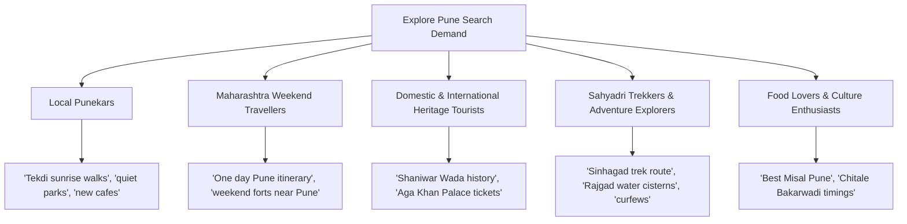

# EXPLORE PUNE — MASTER KEYWORD STRATEGY & SEARCH ONTOLOGY

**Target System:** Explore Pune ([https://explorepune-guide.vercel.app/](https://explorepune-guide.vercel.app/))  
**Date:** November 14, 2026  
**Auditor:** Senior Search Optimization Strategist & Local SEO Specialist  

---

## 1. Search Intent Taxonomy & Audience Segmentation

Explore Pune serves five distinct audience cohorts with differing search intents and linguistic formulations:



### 1.1. User Intent Cohorts
1. **Informational Intent (65% volume):**
   - Queries: "What time does Sinhagad fort open?", "Is Pataleshwar cave temple free?", "History of Shaniwar Wada fire".
   - Destination: Direct FAQ and TouristAttraction entity answers on destination detail pages (`/places/[slug]`).
2. **Transactional & Utility Intent (20% volume):**
   - Queries: "How to reach Sinhagad by PMPML bus", "Pune Metro stations near Dagdusheth Ganpati", "Sinhagad fort vehicle entry fee".
   - Destination: Transit guide modals, Metro line badges, and interactive routing tools.
3. **Exploratory & Planning Intent (15% volume):**
   - Queries: "1-day Pune heritage itinerary", "free places to visit in Pune with family", "budget Pune trip planner".
   - Destination: `/planner` AI generator and `/destinations/free` curated hubs.

---

## 2. Core Keyword Hierarchy & Mapping

### 2.1. Primary Head Terms (High Volume, High Competition)
- `places to visit in Pune` (246,000 monthly searches in India)
- `Pune tourism` (74,000 monthly searches)
- `historical places in Pune` (33,000 monthly searches)
- `tourist places in Pune` (49,500 monthly searches)
- `Pune travel guide` (8,100 monthly searches)
- `Pune 1 day itinerary` (14,800 monthly searches)

### 2.2. Category Silos & High-Intent Long-Tail Keywords

#### A. Sahyadri Hill Forts (`/destinations/forts`)
| Target Keyword | Monthly Search Volume | Search Intent | Target URL |
|---|---|---|---|
| `sinhagad fort trek route` | 27,100 | Informational / Adventure | `/places/sinhagad-fort` |
| `sinhagad fort timings and entry fee` | 18,100 | Transactional / Practical | `/places/sinhagad-fort` |
| `sinhagad fort night curfew rules` | 4,400 | Safety / Legal | `/places/sinhagad-fort` |
| `rajgad fort trek guide from pune` | 9,900 | Adventure / Trekking | `/places/rajgad-fort` |
| `torna fort highest peak pune` | 6,600 | Informational | `/places/torna-fort` |
| `lohagad fort monsoon trek` | 22,200 | Seasonal Adventure | `/places/lohagad-fort` |
| `tikona fort trekking distance` | 8,100 | Adventure | `/places/tikona-fort` |

#### B. Peshwa Architecture & Heritage Wadas (`/destinations/heritage`)
| Target Keyword | Monthly Search Volume | Search Intent | Target URL |
|---|---|---|---|
| `shaniwar wada ticket price online` | 33,100 | Transactional | `/places/shaniwar-wada` |
| `shaniwar wada timings today` | 22,000 | Informational / Live | `/places/shaniwar-wada` |
| `lal mahal pune timings and history` | 8,100 | Historical / Heritage | `/places/lal-mahal` |
| `vishrambaug wada wooden architecture` | 3,600 | Architectural / Culture | `/places/vishrambaug-wada` |
| `aga khan palace entry fee for foreigners` | 12,100 | Transactional | `/places/aga-khan-palace` |

#### C. Sacred Temples & Jyotirlinga Shrines (`/destinations/temples`)
| Target Keyword | Monthly Search Volume | Search Intent | Target URL |
|---|---|---|---|
| `dagdusheth ganpati darshan timings` | 49,500 | Devotional / Live | `/places/dagdusheth-halwai-ganpati` |
| `pataleshwar cave temple shivajinagar entry fee` | 6,600 | Informational | `/places/pataleshwar-cave-temple` |
| `bhimashankar jyotirlinga from pune bus route` | 14,800 | Transit / Devotional | `/places/bhimashankar-temple` |
| `alandi sant dnyaneshwar samadhi temple` | 9,900 | Devotional | `/places/alandi-temple` |
| `omkareshwar temple shaniwar peth pune` | 4,400 | Historical / Spiritual | `/places/omkareshwar-temple` |

#### D. Scenic Nature, Tekdis & Gardens (`/destinations/nature`, `/destinations/parks`)
| Target Keyword | Monthly Search Volume | Search Intent | Target URL |
|---|---|---|---|
| `pu la deshpande garden entry ticket price` | 18,100 | Transactional | `/places/okayama-friendship-garden` |
| `vetal tekdi sunrise timings pune` | 5,400 | Informational | `/places/vetal-tekdi` |
| `khadakwasla dam timings evening` | 14,800 | Leisure | `/places/khadakwasla-dam` |
| `pashan lake bird watching best time` | 2,900 | Eco-tourism | `/places/pashan-lake` |

#### E. Punekar Food Heritage & Iconic Eateries (`/destinations/food`)
| Target Keyword | Monthly Search Volume | Search Intent | Target URL |
|---|---|---|---|
| `best misal in pune list` | 18,100 | Commercial / Review | `/destinations/food` |
| `chitale bandhu bakarwadi buy online pune` | 12,100 | Transactional | `/places/chitale-bandhu-mithaiwale` |
| `sujata mastani fc road branches` | 9,900 | Commercial | `/places/sujata-mastani-heritage` |
| `kayani bakery shrewsbury biscuit timing` | 8,100 | Commercial | `/places/kayani-bakery-camp` |

---

## 3. Bilingual Devanagari (Marathi) Keywords & Regional Search

Marathi search queries represent approximately 25-30% of local mobile queries across Maharashtra:

| Marathi Devanagari Keyword | Meaning & Intent | Optimization Target |
|---|---|---|
| `पुण्यातील पर्यटन स्थळे` | Places to visit in Pune | Homepage & Destinations Index |
| `पुण्यातील ऐतिहासिक किल्ले` | Historic forts in Pune | `/destinations/forts` |
| `सिंहगड किल्ला माहिती मराठी` | Sinhagad fort history in Marathi | `/places/sinhagad-fort` |
| `शनिवार वाडा तिकीट आणि वेळ` | Shaniwar Wada ticket & timing | `/places/shaniwar-wada` |
| `दगडूशेठ गणपती दर्शन वेळ` | Dagdusheth Ganpati darshan time | `/places/dagdusheth-halwai-ganpati` |
| `पुण्यातील प्रसिद्ध वाडे` | Famous wadas in Pune | `/destinations/heritage` |
| `पुणेरी मिसळ प्रसिद्ध ठिकाणे` | Famous Puneri Misal joints | `/destinations/food` |

---

## 4. Semantic Entity & Topic Cluster Architecture

```
                       [ Explore Pune Entity Hub ]
                                    │
    ┌───────────────────────┬───────┴───────────────┬──────────────────────┐
    ▼                       ▼                       ▼                      ▼
[Maratha Forts]       [Peshwa Wadas]         [Sacred Shrines]      [Puneri Culture]
 • Sinhagad            • Shaniwar Wada        • Dagdusheth          • FC Road Eateries
 • Rajgad              • Lal Mahal            • Pataleshwar         • Chitale Bandhu
 • Torna               • Vishrambaug Wada     • Omkareshwar         • Camp Bakeries
 • Lohagad             • Raste Wada           • Bhimashankar        • Tambat Ali Crafts
```

Every destination page establishes semantic entity relationships via:
1. `TouristAttraction` JSON-LD schema linking parent city ("Pune"), administrative area ("Maharashtra"), and country ("India").
2. Geo-coordinates linking to Google Maps spatial entity graph.
3. Category cross-links displaying 4 related contextual landmarks in the same heritage radius.
