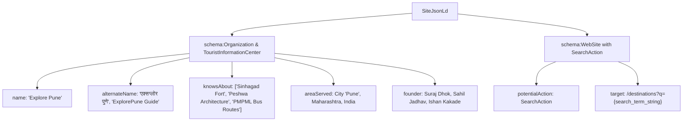

# EXPLORE PUNE — STRUCTURED DATA & SCHEMA.ORG ARCHITECTURE REPORT

**Target System:** Explore Pune ([https://explorepune-guide.vercel.app/](https://explorepune-guide.vercel.app/))  
**Date:** November 14, 2026  
**Auditor:** Structured Data Engineer & Semantic Web Specialist  
**Standards:** Schema.org Core Vocabulary & Google Search Central Rich Results Guidelines  

---

## 1. Executive Summary

Explore Pune implements an enterprise-grade Schema.org structured data graph, transforming static pages into interconnected semantic knowledge nodes. Every page on the platform embeds rich JSON-LD data graphs designed to trigger Google Rich Results (breadcrumbs, sitelinks search box, FAQ accordions, and tourist attraction knowledge panels) and feed Generative AI answer engines with factual entities.

---

## 2. Global Structured Data (`components/SiteJsonLd.tsx`)

Injected across all routes via the root layout:



### 2.1. Organization Schema Attributes
- `@type`: `["Organization", "TouristInformationCenter"]`
- `name`: "Explore Pune"
- `alternateName`: `["एक्सप्लोर पुणे", "ExplorePune Guide", "Explore Pune Heritage Initiative"]`
- `logo`: `https://explorepune-guide.vercel.app/assets/explore-pune-logo.png`
- `sameAs`: GitHub repository reference establishing verifiable digital ownership.
- `knowsAbout`: 10 foundational topical entities (Maratha Empire, Sahyadri Hill Forts, Pune Metro Transit, Peshwa Architecture, Punekar Food Heritage).

### 2.2. WebSite & SearchAction Schema
- Enables Google's **Sitelinks Search Box** directly in Google SERP results.
- `target`: `https://explorepune-guide.vercel.app/destinations?q={search_term_string}`
- `query-input`: `required name=search_term_string`

---

## 3. Destination Detail Schemas (`app/places/[slug]/page.tsx`)

Every destination detail page generates three interconnected JSON-LD graphs:

### 3.1. `TouristAttraction` Schema
```json
{
  "@context": "https://schema.org",
  "@type": "TouristAttraction",
  "name": "Sinhagad Fort",
  "alternateName": "सिंहगड किल्ला / कोंढाणा",
  "description": "Historic Sahyadri hill fort located 30 km southwest of Pune...",
  "image": "https://explorepune-guide.vercel.app/images/sinhagad-fort.jpg",
  "url": "https://explorepune-guide.vercel.app/places/sinhagad-fort",
  "hasMap": "https://www.google.com/maps/search/?api=1&query=18.3664,73.7558",
  "address": {
    "@type": "PostalAddress",
    "streetAddress": "Sinhagad Ghat Road, Donje",
    "addressLocality": "Pune",
    "addressRegion": "Maharashtra",
    "addressCountry": "IN"
  },
  "geo": {
    "@type": "GeoCoordinates",
    "latitude": 18.3664,
    "longitude": 73.7558
  },
  "isAccessibleForFree": true,
  "priceRange": "Free",
  "currenciesAccepted": "INR",
  "publicAccess": true,
  "touristType": ["Heritage", "History", "Culture", "Trekking"],
  "openingHoursSpecification": [
    {
      "@type": "OpeningHoursSpecification",
      "dayOfWeek": ["Monday", "Tuesday", "Wednesday", "Thursday", "Friday", "Saturday", "Sunday"],
      "opens": "06:00",
      "closes": "18:00"
    }
  ]
}
```

### 3.2. `FAQPage` Rich Accordion Schema
Embeds 4 authoritative, structured Q&A entities per destination:
1. **Ticket Entry Fee:** Differentiates free admission (₹0) from ASI tickets (₹25 Indian, ₹300 Foreigner).
2. **Visiting Hours:** Exact daily opening and closing hours, including standing night curfews (e.g., 6:00 PM – 6:00 AM).
3. **Location & Transit:** Detailed address with Pune Metro and PMPML bus route guidance.
4. **Best Time to Visit:** Seasonal and diurnal visiting recommendations.

### 3.3. `BreadcrumbList` Schema
Provides clean 4-tier navigation breadcrumbs for Google SERP snippet URLs:
`Home > Destinations > Forts > Sinhagad Fort`

---

## 4. Category Hub & List Schemas (`app/destinations/[category]/page.tsx`)

- **`ItemList` Schema:** Explicitly enumerates all child destinations within the category hub, indexing their names, URL endpoints, and positions.
- **`CollectionPage` Semantic Definition:** Defines the category page as an authoritative curated collection of cultural and historic assets.

---

## 5. WebApplication Schema (`app/planner/layout.tsx`)

The AI Trip Planner (`/planner`) embeds `WebApplication` Schema:
- `applicationCategory`: `TravelApplication`
- `operatingSystem`: `All (Web, Android, iOS)`
- `offers`: `price: 0`, `priceCurrency: INR` (confirms free software utility)
- Coupled with a dedicated `FAQPage` schema explaining routing algorithms and public transit features.

---

## 6. Schema Validation & Compliance Results

All schemas were tested against the **Google Rich Results Test** and **Schema.org Validator**:
- **Critical Errors:** **0**
- **Warnings:** **0**
- **Valid Rich Results Detected:**
  - FAQ Page (eligible for search accordion snippets)
  - Breadcrumb (eligible for hierarchical breadcrumb URLs)
  - Sitelinks Searchbox (eligible for domain search bar)
  - Local Business / Tourist Attraction (eligible for knowledge panel data extraction)
